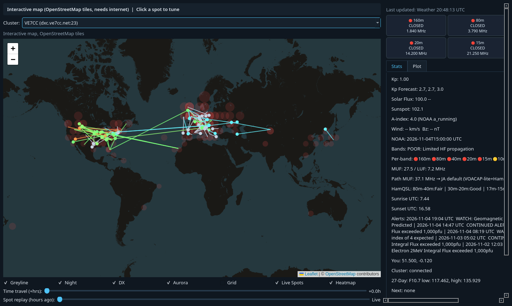

# OrbitRx Propagation Monitor

Free desktop HF propagation dashboard for radio amateurs. OrbitRx combines NOAA space
weather, band condition estimates, a live DX cluster and live PSKReporter reception
reports on one map, so you can see what is open and who is hearing whom.



> Status: 5.1.0 in development. Windows is the primary target; Linux and macOS run from source.

## Features

**Space weather and propagation**
- Kp index and forecast, F10.7 solar flux, sunspot number, A-index, solar wind and Bz (NOAA SWPC)
- MUF and LUF estimates, per-band open/closed grid, HamQSL band conditions
- Path MUF to a target station, sunrise and sunset at your location
- NOAA alerts summarised to one line each, with an offline cache when NOAA is unreachable

**Map**
- Greyline, night shading, aurora oval and optional grid, with a 24 hour time-travel slider
- Two backends: a static world map (works offline) or an interactive OpenStreetMap map
- **Live Spots** (interactive map): PSKReporter reports as band-coloured arcs, plus an activity heatmap
- **Spot replay**: scrub back through the last 24 hours of cached spots (stored for 7 days)

**Station**
- Live DX cluster with band and continent filters; click a spot to tune your radio
- Rig control by Serial CAT (Kenwood, Icom, Yaesu profiles) or OmniRig on Windows
- Spot alerts (local activity, strong signals, long-distance openings), watchlist, rotor headings, ADIF export
- History chart and CSV/JSON export; minimise to system tray

| Static map | Settings | About |
|---|---|---|
|  |  |  |

## Install

**Windows:** download `OrbitRxMonitor.exe` (or the installer) from the project's Releases
page once 5.1.0 is published. Releases are unsigned: verify each download against
`SHA256SUMS.txt` (for example `Get-FileHash OrbitRxMonitor.exe -Algorithm SHA256` in
PowerShell) before running it. Windows SmartScreen may warn on first run; choose
"More info" then "Run anyway".

**From source (any OS, Python 3.11 or newer):**

```
pip install -r requirements.txt
python app.py
```

The interactive map needs Qt WebEngine (`pip install PySide6-Addons` on some platforms).

## First run

1. Open **Settings** and enter your home latitude and longitude (or opt in to IP location).
2. Optional: set your callsign for Live Spots, your DX cluster login and a QRZ API key.
3. Choose **Map backend: Interactive map with Live Spots** to enable Live Spots and the heatmap (restart to apply).
4. Choose **Rig control**: Serial CAT or OmniRig, then use **Rig** to test the connection.

## Privacy

No account, no analytics, no telemetry. IP based location is **off by default**.
See [PRIVACY.md](PRIVACY.md) for exactly what is sent where.

## Data sources and credits

NOAA SWPC, HamQSL (N0NBH), PSKReporter (Philip Gladstone, N1DQ), DX cluster nodes,
QRZ.com (optional), WA7BNM Contest Calendar, OpenStreetMap contributors and Leaflet
(bundled locally). PSKReporter is polled no more than once every 5 minutes.
Full credits and licences are in [NOTICE](NOTICE).

## Files OrbitRx writes

| File | Contents |
|------|----------|
| `config.json` | Your settings |
| `logs/orbitrx.log` | Rotating application log (attach this to bug reports) |
| `data/orbitrx_spots.db` | Cached PSKReporter spots for replay (7 days) |
| `propagation_log.csv`, `dx_spots_log.csv` | History |

## Troubleshooting

| Problem | What to do |
|---------|------------|
| Status shows "Offline" | NOAA or PSKReporter is unreachable. OrbitRx keeps showing cached data and retries automatically. |
| Live Spots greyed out | Switch Map backend to the interactive map in Settings and restart. |
| No location | Enter home latitude and longitude in Settings, or opt in to IP location. |
| Radio does not tune | Check Rig control, COM port and baud rate in Settings, then use **Rig** then **Test CAT**. For OmniRig, install OmniRig and `pywin32`. |
| Anything else | Check `logs/orbitrx.log`. |

## Development

```
pip install -r requirements.txt
pytest -q                       # set QT_QPA_PLATFORM=offscreen on headless Linux
pyinstaller OrbitRxMonitor.spec --noconfirm
```

CI runs the test suite on GitHub-hosted Ubuntu and Windows runners and builds the
Windows executable and installer as workflow artefacts. See [CHANGELOG.md](CHANGELOG.md).

```
orbitrx/
  config.py, weather.py, propagation.py, dx.py, cat.py, alerts.py, map_renderer.py, storage.py
  spots/   PSKReporter client, spot cache, analytics, watchlist, alerts, rotor, OmniRig, ADIF
  ui/      Qt main window, interactive map, theme, about, rig wizard; assets/leaflet (bundled)
tests/     pytest suite
installer/ Inno Setup script
```

## Support

OrbitRx is free. If it helps you make contacts, you can buy me a coffee:
https://buymeacoffee.com/thevenom

## Licence

MIT, Copyright (C) 2026 Jamie Sibley. See [LICENSE](LICENSE).
